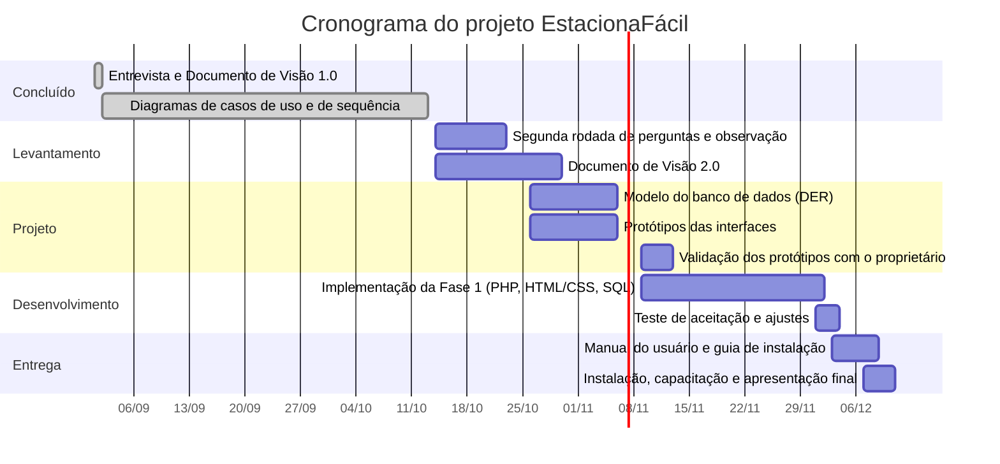
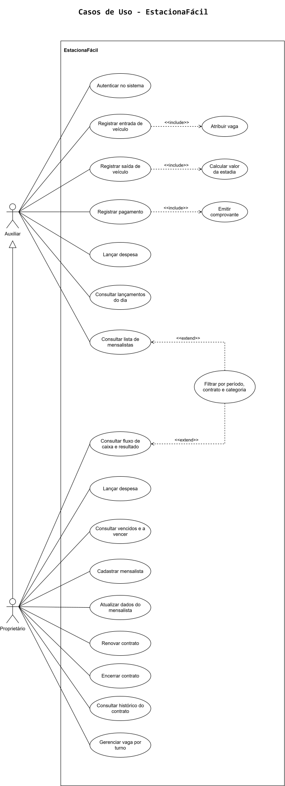

# EstacionaFácil

Sistema web de gestão para um estacionamento de pequeno porte, com controle de mensalistas, vencimentos, pagamentos, despesas e resultado financeiro.

> **Status do projeto:** 🚧 Fase inicial — especificação e modelagem concluídas, desenvolvimento a iniciar

---

## 📋 Descrição do desafio

### Narrativa

O EstacionaFácil nasceu como trabalho da disciplina de Engenharia de Software, a partir de um desafio com cliente fictício: um estacionamento tradicional do centro da cidade, pressionado por concorrentes que oferecem vagas cobertas, contratos diversos, serviços agregados e autoatendimento por aplicativo.

No Projeto Integrador IV (Curricularização da Extensão), o projeto passou a atender um **estacionamento real de pequeno porte, no Centro de Taubaté**. A entrevista com o proprietário mostrou que a realidade é outra: o pátio tem 49 vagas (35 para carros e 14 para motos), fica sempre lotado, a clientela é quase toda de **mensalistas**, e toda a gestão é feita em papel. As dificuldades dele são saber quem são os mensalistas, quando cada contrato vence e qual é o resultado do mês depois de pagar água, luz e aluguel.

Por isso o escopo foi revisado: o sistema foca em **contratos, cobrança, despesas e resultado**, e deixou de lado o que o estabelecimento não usa, como serviços agregados e análise de avaliações.

### User stories

**Auxiliar** (lançamento diário)

| ID | História |
|---|---|
| US01 | Como Auxiliar, quero entrar no sistema com meu login e senha, para acessar apenas o que meu perfil permite. |
| US02 | Como Auxiliar, quero registrar o pagamento de uma mensalidade escolhendo a forma de pagamento, para ter o recebimento anotado e entregar um comprovante ao cliente. |
| US03 | Como Auxiliar, quero lançar uma despesa fixa ou variável, para que as contas do estacionamento entrem no resultado do mês. |
| US04 | Como Auxiliar, quero consultar os lançamentos do dia e a lista de mensalistas, para conferir o que foi registrado no turno anterior e saber se uma placa é de um mensalista em dia. |
| US05 | *(Fase 2)* Como Auxiliar, quero registrar a entrada de um veículo avulso e atribuir uma vaga, para saber onde ele está. |
| US06 | *(Fase 2)* Como Auxiliar, quero registrar a saída de um veículo avulso com o valor da estadia calculado, para cobrar o valor correto. |

**Proprietário** (acesso pleno, herda tudo o que o Auxiliar faz)

| ID | História |
|---|---|
| US07 | Como Proprietário, quero cadastrar um mensalista com veículo, vaga e valor contratado, para ter a carteira de clientes registrada e não apenas em anotações. |
| US08 | Como Proprietário, quero atualizar os dados de um mensalista, para manter placa, telefone e vaga sempre corretos. |
| US09 | Como Proprietário, quero renovar o contrato de um mensalista, para manter a vigência atualizada. |
| US10 | Como Proprietário, quero encerrar o contrato de um mensalista que saiu, para liberar a vaga sem perder o histórico. |
| US11 | Como Proprietário, quero consultar o histórico de um contrato, para saber renovações e pagamentos anteriores. |
| US12 | Como Proprietário, quero ver os contratos vencidos e a vencer, para cobrar antes que a inadimplência cresça. |
| US13 | Como Proprietário, quero consultar o fluxo de caixa e o resultado do período, filtrando por período, tipo de contrato e categoria de veículo, para saber se o mês foi lucrativo depois de pagar as contas fixas. |
| US14 | *(Fase 2)* Como Proprietário, quero gerenciar a vaga por turno, para vender a mesma vaga a mensalistas diurnos e noturnos sem conflito de horário. |

> As histórias foram redigidas a partir da entrevista com o proprietário e dos casos de uso. Ainda precisam ser validadas com ele.

---

## ⚙️ Escopo do produto (backlog do produto)

| ID | Item | Requisito | Fase | Histórias | Status |
|---|---|---|---|---|---|
| PB01 | Acesso por perfil (Auxiliar e Proprietário) | RF01 | 1 | US01 | Modelado |
| PB02 | Gestão de mensalistas e contratos: cadastro, atualização, renovação, encerramento e histórico | RF04 | 1 | US07 a US11 | Modelado |
| PB03 | Registro de pagamentos (Dinheiro, Pix, Débito e Crédito) com comprovante | RF05 | 1 | US02 | Modelado |
| PB04 | Controle de vencimentos: contratos vencidos e a vencer | RF13 | 1 | US12 | Modelado |
| PB05 | Lançamento de despesas fixas (com recorrência mensal) e variáveis | RF11 | 1 | US03 | Modelado |
| PB06 | Fluxo de caixa e resultado do período | RF12 | 1 | US13 | Modelado |
| PB07 | Filtros por período, tipo de contrato e categoria de veículo | RF10 | 1 | US13 | Modelado |
| PB08 | Consultas operacionais: lançamentos do dia e lista de mensalistas | RF04, RF05 | 1 | US04 | Modelado |
| PB09 | Registro de entrada de veículo avulso | RF02 | 2 | US05 | Modelado |
| PB10 | Registro de saída com cálculo da estadia | RF03 | 2 | US06 | Modelado |
| PB11 | Gestão de vaga por turno | RF14 | 2 | US14 | Modelado |

**Status:** *Modelado* significa que o caso de uso e o diagrama de sequência estão prontos. Nenhum item foi desenvolvido ainda.

**Fora do escopo:** serviços adicionais (lava-jato, reparos, estética), canal de avaliações, classificação de feedbacks, alertas de satisfação e aplicativo de reserva antecipada, porque o estabelecimento não oferece esses serviços nem tem o volume que os justifique.

### Requisitos não funcionais

- Manual do usuário em linguagem acessível, ilustrado com telas reais (requisito crítico, pelo perfil do usuário)
- Guia de instalação e configuração do ambiente
- Modelagem do banco de dados relacional (DER, no MySQL Workbench)
- Painel responsivo, compatível com Chrome, Firefox e Edge
- Armazenamento seguro de dados sensíveis (dados pessoais e financeiros dos mensalistas e acessos), seguindo boas práticas de proteção de dados
- Tempo de resposta inferior a 2 segundos no registro de entrada e saída (Fase 2)

---

## 📅 Cronograma do projeto

O cronograma abaixo cobre a Fase 1 até o fim do semestre, em dezembro de 2026. A Fase 2 não tem prazo definido (a definir).



> As datas futuras são uma proposta de planejamento e podem ser ajustadas conforme as visitas ao estabelecimento.

---

## 📦 Partes entregáveis (backlog da sprint)

| Entregável | Descrição | Responsável | Prazo | Status |
|---|---|---|---|---|
| Documento de Visão 1.0 | Descrição do desafio, requisitos e pilha tecnológica | Felipe | 01/09/2026 | Concluído |
| Diagramas de casos de uso e de sequência | 1 diagrama de casos de uso e 12 de sequência, com códigos HTTP | Júlia | 13/10/2026 | Concluído |
| Segunda rodada de perguntas | Coleta das lacunas de modelagem (Apêndice C do relatório extensionista) | Daniel | 23/10/2026 | A desenvolver |
| Documento de Visão 2.0 | Reclassificação dos requisitos, RF11 a RF14 e rastreabilidade | Felipe | 30/10/2026 | A desenvolver |
| Modelo do banco de dados | DER no MySQL Workbench | Maria Luiza | 06/11/2026 | A desenvolver |
| Protótipos das interfaces | Painel do proprietário, cadastro de mensalistas e lançamento de caixa | Mateus | 06/11/2026 | A desenvolver |
| Validação dos protótipos | Apresentação das telas ao proprietário, com ajustes | Daniel e Mateus | 13/11/2026 | A desenvolver |
| Implementação da Fase 1 | Módulos em PHP, HTML/CSS e SQL | Paulo e Mateus | 02/12/2026 | A desenvolver |
| Teste de aceitação | Execução pelo proprietário de um cadastro, um pagamento, uma despesa e leitura do painel | Todos | 04/12/2026 | A desenvolver |
| Manual do usuário | Será criado com a finalização do desenvolvimento | Todos | 09/12/2026 | A desenvolver |
| Guia de instalação e configuração | Implantação no computador do estabelecimento | Todos | 09/12/2026 | A desenvolver |
| Instalação, capacitação e apresentação final | Oficina presencial e apresentação dos resultados | Todos | 11/12/2026 | A desenvolver |

---

## 🛠️ Tecnologias utilizadas

| Camada | Tecnologia | Propósito |
|---|---|---|
| Interface | HTML5 e CSS3, sem framework | Simplicidade de manutenção e de leitura do código, com compatibilidade com Chrome, Firefox e Edge |
| Processamento | PHP | Linguagem dominada pela equipe, de licença livre e ampla documentação, executável em servidor local sem custo |
| Persistência | MySQL, modelado no MySQL Workbench | Banco relacional gratuito, adequado ao volume do estabelecimento e usado para o DER |
| Ambiente de execução | Servidor local (XAMPP ou equivalente) | Funciona sem conexão estável de internet, no computador que o estabelecimento já tem, sem custo de hospedagem |
| Versionamento | Git e GitHub | Controle de versão do código e da documentação |
| Modelagem | PlantUML | Diagramas UML escritos como código, versionados junto do projeto |

---

## 📐 Modelagem

A modelagem usa UML (casos de uso e diagramas de sequência), escrita em PlantUML.



- [Todos os diagramas](./docs/diagramas/README.md)
- [Rotas da API](./docs/api.md): proposta de rotas HTTP e códigos de resposta.

---

## 📚 Documentação adicional

### Manual do usuário

Será criado com a finalização do desenvolvimento, em linguagem acessível e ilustrado com telas reais do sistema. Link a definir.

### Guia de instalação e configuração

Será desenvolvido junto com o manual. Link a definir.

### Identidade da equipe

| Integrante | Contato | Responsabilidade |
|---|---|---|
| Daniel Oliveira Rodrigues | A definir | Relação com o parceiro externo: agendamento, condução das entrevistas, visitas ao estabelecimento e registro das evidências |
| Eduardo Alves Teixeira | [GitHub](https://github.com/ed-ateixeira) | Interface: protótipos e desenvolvimento das telas em HTML, CSS e JavaScript |
| Felipe Salles Barlaam | [GitHub](https://github.com/Fesbz) | Engenharia de requisitos e manutenção do Documento de Visão |
| Júlia Cesar dos Santos | [GitHub](https://github.com/JuliaCss) | Modelagem UML: casos de uso, classes e diagramas de sequência |
| Maria Luiza Ribeiro Batista | [GitHub](https://github.com/mlrBatista) | Modelagem e implementação do banco de dados relacional |
| Mateus Lotufo Silvestre | [GitHub](https://github.com/lotufo22) | Interface: protótipos e desenvolvimento das telas em HTML e CSS |
| Paulo Vinicius Ferreira | A definir | Desenvolvimento em PHP e integração com o banco de dados |

Compartilhado por todos: documentação do projeto, testes, elaboração do manual do usuário e condução da oficina de capacitação junto ao parceiro.

---

## 🗂️ Estrutura do repositório

```
.
├── docs/
│   ├── diagramas/     # Casos de uso e sequências (.puml)
│   └── api.md         # Rotas da API (proposta)
├── src/               # Código-fonte da aplicação
├── README.md
└── CONTRIBUTING.md    # Guia de fluxo de trabalho em equipe (branches, PRs, commits)
```

> A estrutura acima é um ponto de partida e será ajustada conforme o projeto avança.

---

## 🚀 Como começar

```bash
# Clonar o repositório
git clone https://github.com/lotufo22/estaciona-facil.git
cd estaciona-facil
```

Instruções de instalação e configuração do ambiente serão adicionadas aqui conforme a stack do projeto for definida.

---

## 🤝 Como contribuir

Antes de começar a trabalhar, leia o [`CONTRIBUTING.md`](./CONTRIBUTING.md) — ele define o fluxo de branches, padrão de commits e como abrir Pull Requests.

Resumo rápido:
1. Crie uma branch a partir da `main` (`feature/nome-da-tarefa`)
2. Faça commits seguindo o padrão descrito no guia
3. Abra um Pull Request e peça revisão de outro integrante
4. Após aprovação, faça o merge e remova a branch

---

## 📄 Licença

_A definir._
