# Manual do usuário do EstacionaFácil

O EstacionaFácil ajuda a saber **quem são os mensalistas**, **quando cada contrato vence**, **quem está em
atraso** e **qual foi o resultado do mês** depois de pagar as despesas. Funciona no navegador (Chrome,
Edge ou Firefox), no computador ou no celular.

Este manual foi escrito para quem **nunca usou** um sistema assim. Se alguma tela não for como está
descrito aqui, avise a equipe: o manual deve ser corrigido.

## 1. Como entrar e sair

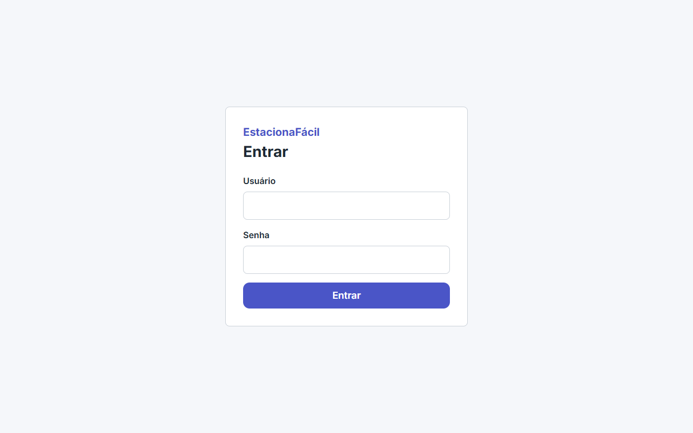

1. Abra o endereço do sistema no navegador.
2. Digite o **Usuário** e a **Senha** e clique em **Entrar**.
3. Para sair, clique em **Sair** (canto superior direito). Faça isso sempre que deixar o computador.

- Se errar a senha **5 vezes em 15 minutos**, o sistema pede para aguardar 15 minutos antes de tentar de novo.
- Se ficar **12 horas sem usar**, o sistema pede para entrar de novo ("Sua sessão expirou"). Nada se perde.
- Não existe senha padrão. Quem instalou o sistema criou o seu usuário. Esqueceu a senha? Peça a quem
  instalou para criar uma nova.

## 2. Quem vê o quê

| Aba | Proprietário | Auxiliar |
|---|:---:|:---:|
| Painel | ✅ | ❌ |
| Mensalistas | ✅ (cadastra, edita, renova, encerra) | ✅ (só consulta) |
| Vencimentos | ✅ | ❌ |
| Recebimentos | ✅ | ✅ |
| Despesas | ✅ | ✅ (lança, mas não pausa despesa fixa) |
| Fluxo de caixa | ✅ | ❌ |

O **Proprietário** abre no Painel. O **Auxiliar** abre direto em Recebimentos, que é o que ele usa o
dia todo. Se o Auxiliar tentar abrir uma página que não é dele, o sistema o devolve para Recebimentos.

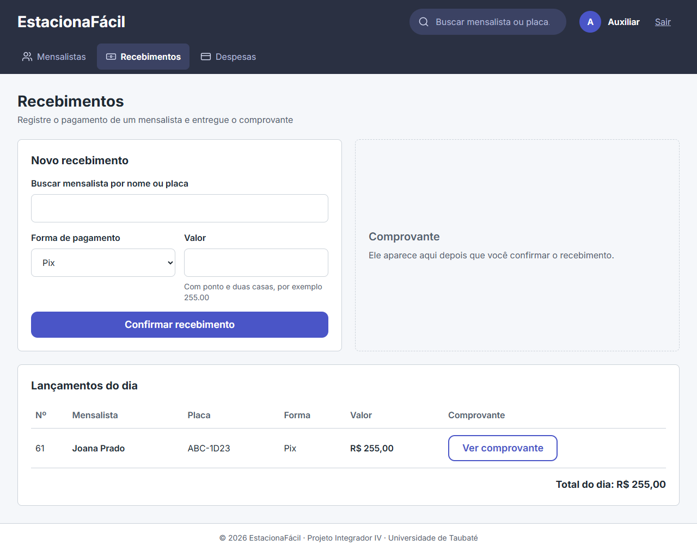

## 3. Painel (só Proprietário)

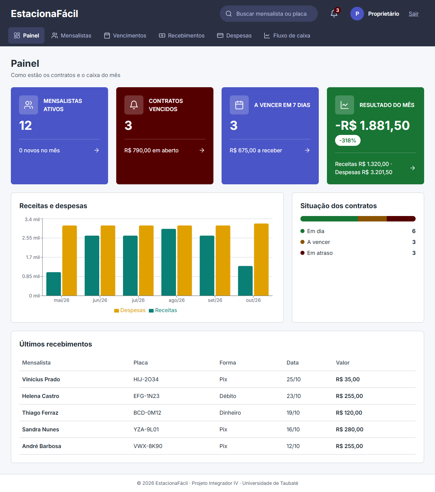

É o resumo do negócio. No topo, quatro quadros:

- **Mensalistas ativos:** quantos contratos estão valendo, e quantos entraram neste mês.
- **Contratos vencidos:** quantos estão em atraso e **quanto dinheiro está em aberto**.
- **A vencer em 7 dias:** quantos vencem na próxima semana e quanto vão render.
- **Resultado do mês:** o que entrou menos o que saiu. Pode ser **negativo** (aparece com o sinal de
  menos). A porcentagem mostra se está melhor ou pior que o mês passado.

Abaixo: o gráfico de receitas e despesas dos últimos 6 meses, a **situação dos contratos** (em dia, a
vencer, em atraso) e os **últimos recebimentos**. O sininho no topo mostra quantos contratos estão em
atraso; clique nele para ver quais.

## 4. Mensalistas

### Ver e procurar

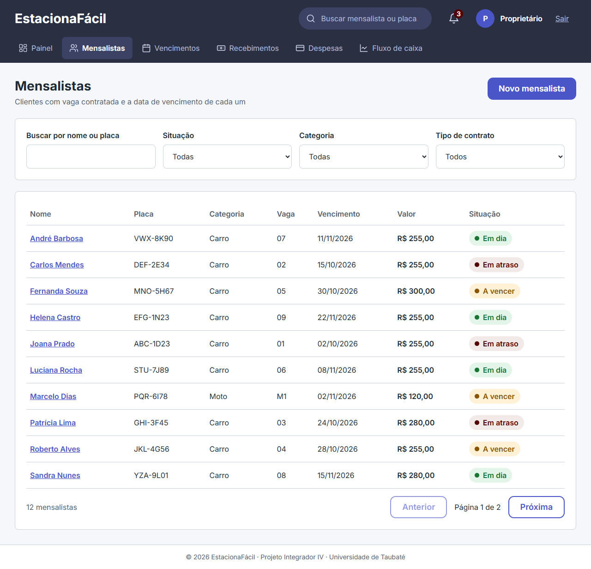

A lista mostra nome, placa, vaga, vencimento, valor e a **situação**. Use **Buscar por nome ou placa**
(a placa pode ser digitada de qualquer jeito: `abc1d23`, `ABC-1D23`…) e os filtros de situação,
categoria e tipo de contrato. Clique no nome para abrir os detalhes.

### Cadastrar um mensalista (Proprietário)

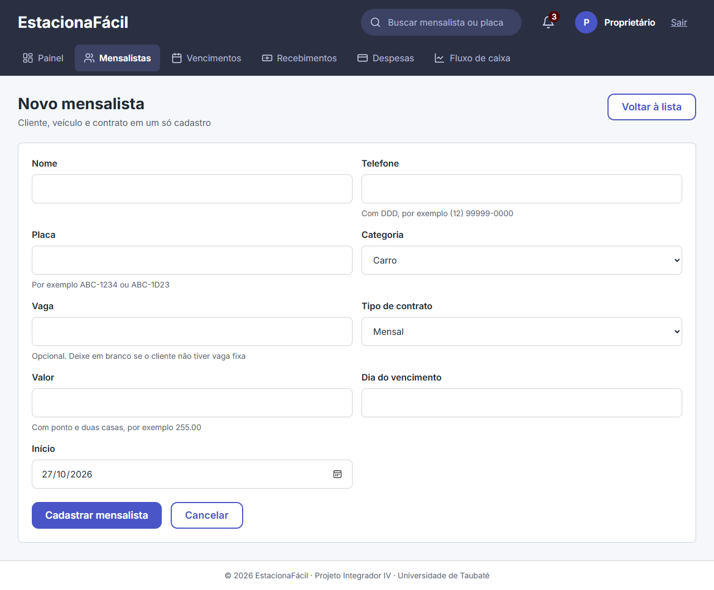

1. Em **Mensalistas**, clique em **Novo mensalista**.
2. Preencha:
   - **Nome** e **Telefone** (com DDD).
   - **Placa**: `ABC-1234` ou `ABC-1D23`.
   - **Categoria**: carro ou moto.
   - **Vaga** (opcional): `01` a `35` para carro e `M1` a `M14` para moto. Deixe em branco se o cliente
     não tiver vaga fixa.
   - **Tipo de contrato**: mensal ou semanal.
   - **Valor**: **com ponto e duas casas**, por exemplo `255.00` (não use vírgula).
   - **Dia do vencimento**: de 1 a 31. Em meses curtos o vencimento cai no último dia do mês (dia 31
     em fevereiro vira 28 ou 29) e volta ao dia certo no mês seguinte.
   - **Início**: a data em que o contrato começa.
3. Clique em **Cadastrar mensalista**.

O sistema avisa, **no próprio campo**, se algo estiver errado:

- *"Esta placa já tem contrato ativo"*: já existe um contrato valendo para essa placa.
- *"Esta vaga já está ocupada"*: outro cliente ativo está nessa vaga.
- Vaga de moto para carro (ou o contrário), ou vaga que não existe, também são recusadas.

### Detalhes de um mensalista

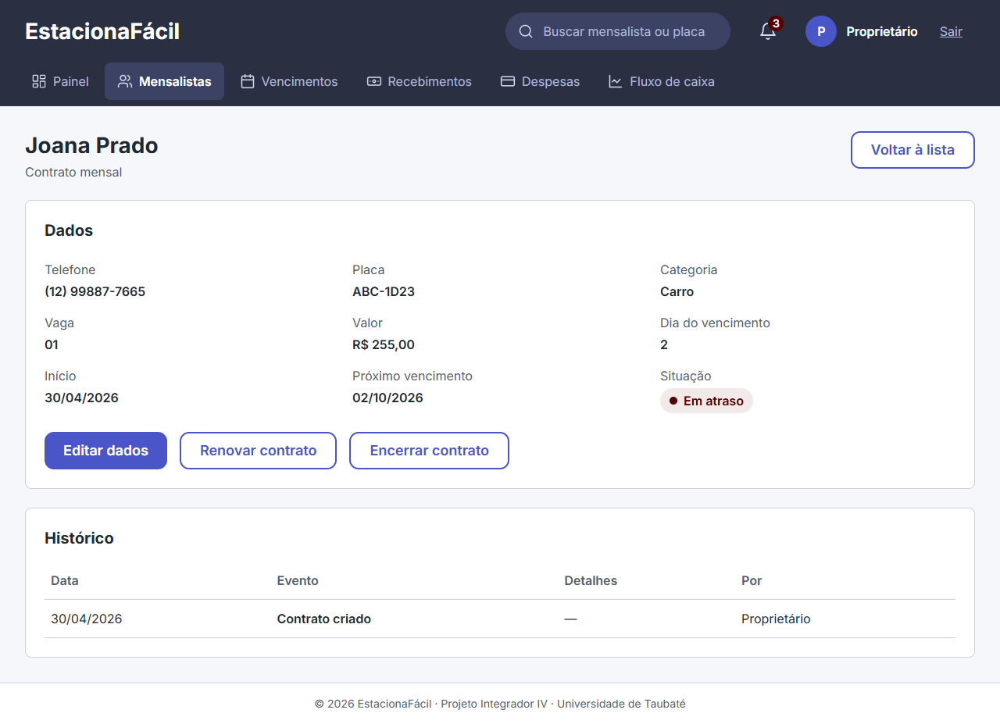

Mostra os dados, o próximo vencimento, a situação e o **histórico** (quando o contrato foi criado,
renovado, pago ou encerrado, e por quem). Para o Proprietário há três botões:

- **Editar dados:** muda telefone, placa, vaga e valor.
- **Renovar contrato:** estende o vencimento **sem receber pagamento** (por exemplo, um mês de cortesia).
  Informe os **meses** e o **Motivo**; o motivo fica no histórico. Para receber dinheiro, use Recebimentos.
- **Encerrar contrato:** o cliente deixou de ser mensalista. Pede confirmação. A **vaga e a placa ficam
  livres** para um novo contrato. Um contrato encerrado não pode mais receber pagamento nem ser renovado.

## 5. Situação dos contratos

A situação **nunca é digitada**: o sistema calcula pela data de vencimento, sempre com **texto** (não só
cor).

| Situação | Quando |
|---|---|
| **Em atraso** | o vencimento já passou |
| **A vencer** | faltam de 0 a 7 dias para vencer |
| **Em dia** | os demais casos |

## 6. Vencimentos (só Proprietário)

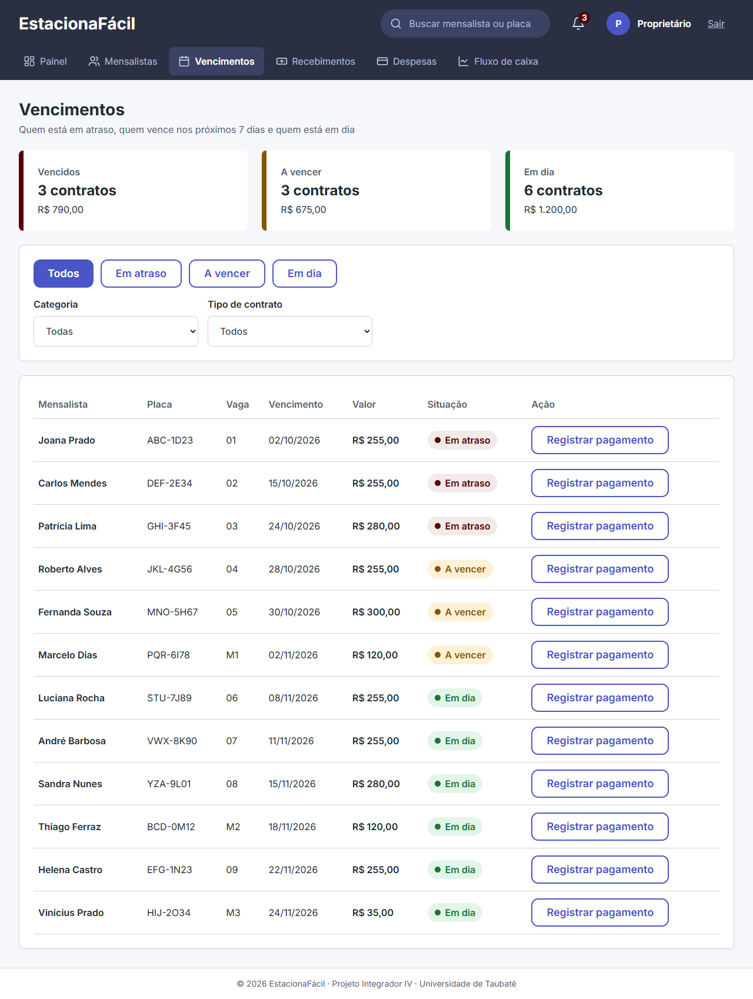

Três quadros no topo mostram quantos contratos e quanto dinheiro há em cada situação. Os botões
**Todos / Em atraso / A vencer / Em dia** filtram a tabela (os quadros do topo continuam mostrando as
três). A tabela vem em ordem de vencimento, do mais antigo ao mais novo, e cada linha tem o botão
**Registrar pagamento**.

## 7. Recebimentos

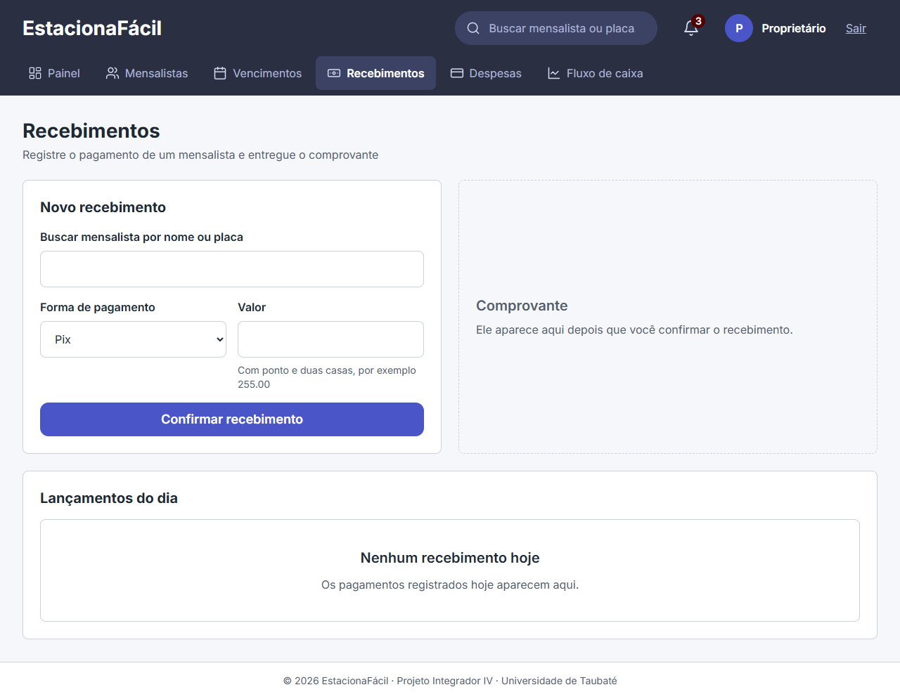

É a tela do dia a dia: o cliente chegou para pagar.

1. Digite parte do **nome** ou a **placa** em *Buscar mensalista por nome ou placa* e clique no cliente
   certo.
2. Escolha a **Forma de pagamento** (Pix, dinheiro, débito ou crédito). O **Valor** já vem preenchido
   com o valor do contrato; confira.
3. Clique **uma vez** em **Confirmar recebimento**.

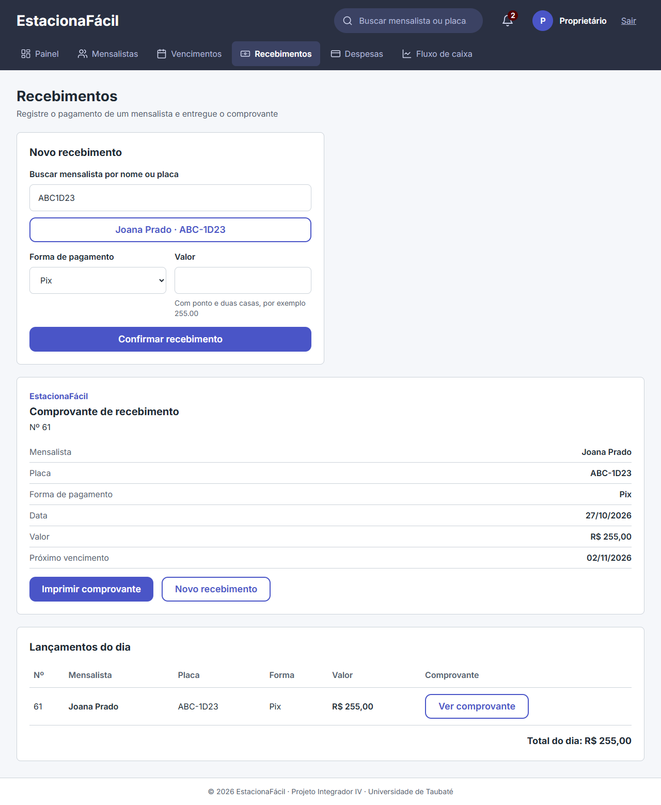

O sistema mostra o **comprovante** (com número, cliente, placa, forma, data, valor e **próximo
vencimento**). Clique em **Imprimir comprovante** para entregar ao cliente, ou em **Novo recebimento**
para o próximo. A lista **Lançamentos do dia** mostra o que já foi recebido hoje e o **total do dia**;
o botão **Ver comprovante** reabre qualquer um.

Pontos importantes:

- **Clicar duas vezes não cobra duas vezes.** Se a internet estiver lenta e você clicar de novo, o sistema
  reconhece que é o mesmo pagamento e registra **um só**.
- **Cada pagamento cobre um mês** (ou uma semana, no contrato semanal) **a partir do vencimento atual**,
  não a partir de hoje. Se o cliente deve **três meses**, um pagamento quita só o mais antigo e ele
  continua em atraso até pagar os outros. Registre um pagamento por mês devido.
- Contrato **encerrado** não recebe pagamento.
- Pagamento registrado **não pode ser apagado**. Se errou, avise o Proprietário.

## 8. Despesas

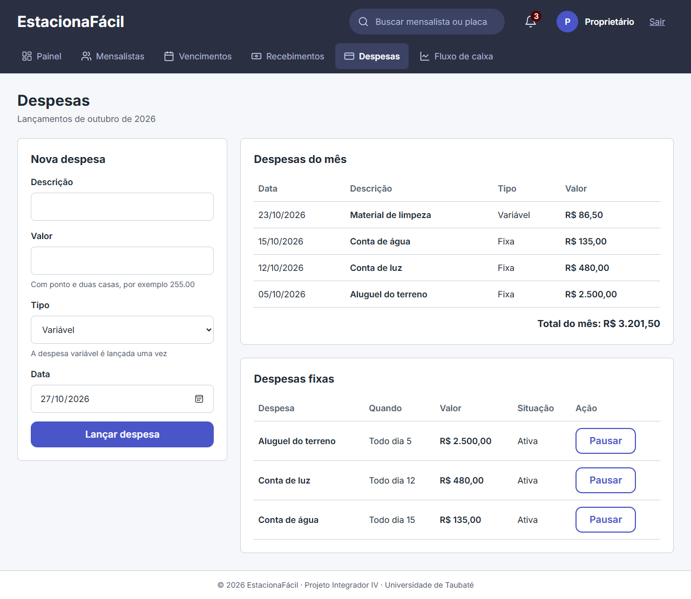

Para lançar uma despesa, preencha **Descrição**, **Valor** (com ponto, por exemplo `86.50`), **Tipo** e
**Data**, e clique em **Lançar despesa**.

- **Variável** é uma despesa que acontece uma vez (material de limpeza, conserto).
- **Fixa** repete **todo mês** (aluguel, luz, água). Ao escolher *Fixa*, aparece o **Dia do mês**. O
  sistema lança a despesa no mês atual e **cria sozinho o lançamento dos meses seguintes**, no dia certo,
  sem duplicar. Em meses curtos, uma despesa do dia 31 cai no último dia do mês.

A tabela **Despesas fixas** lista as que se repetem. O Proprietário pode **Pausar** uma (por exemplo,
quando o contrato do aluguel acaba) e **Retomar** depois. Pausar não apaga o que já foi lançado.

## 9. Fluxo de caixa (só Proprietário)

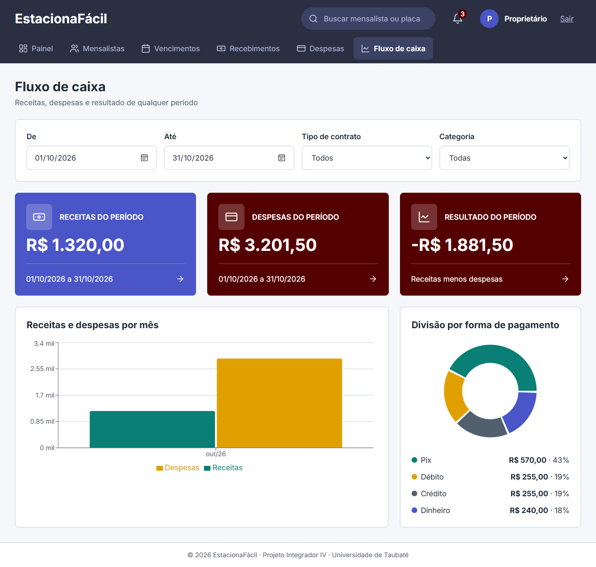

Mostra **quanto entrou, quanto saiu e o resultado** de qualquer período. Escolha as datas em **De** e
**Até** (por padrão, o mês atual).

- **Receitas do período:** soma dos recebimentos pela **data em que foram pagos**.
- **Despesas do período:** soma das despesas pela **data da despesa**.
- **Resultado do período:** receitas menos despesas. **Pode ser negativo.**
- Os gráficos mostram o resultado mês a mês e a **divisão dos recebimentos por forma de pagamento**.

**Filtros de Tipo de contrato e Categoria** (carro ou moto) mudam só as **receitas**, porque despesas não
pertencem a um contrato nem a um veículo. Por isso, **com um desses filtros ligado, o resultado some** e o
sistema avisa o motivo. Volte o filtro para *Todos/Todas* para ver o resultado.

## 10. Usando no celular

O sistema funciona no navegador do celular, sem instalar nada. Abra o mesmo endereço e entre com o seu
usuário e senha. As telas se ajustam ao tamanho da tela:

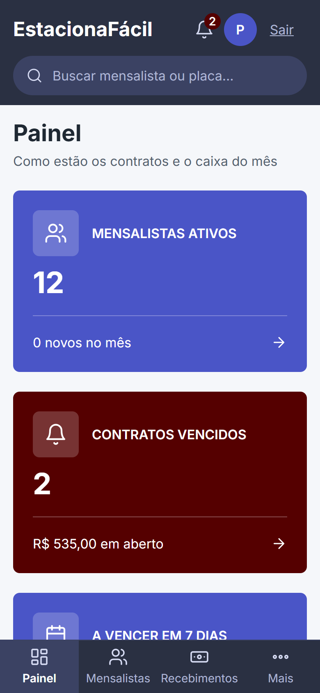

- **No alto da tela** ficam o nome do sistema, o **sininho** (contratos em atraso), a sua inicial e o botão
  **Sair**. Logo abaixo está a **busca** por nome ou placa, para ver na hora se um cliente está em dia.
- **Embaixo da tela** ficam as abas, ao alcance do polegar. Ficam sempre à mostra **Painel**, **Mensalistas**
  e **Recebimentos**. Para as outras, toque em **Mais**:

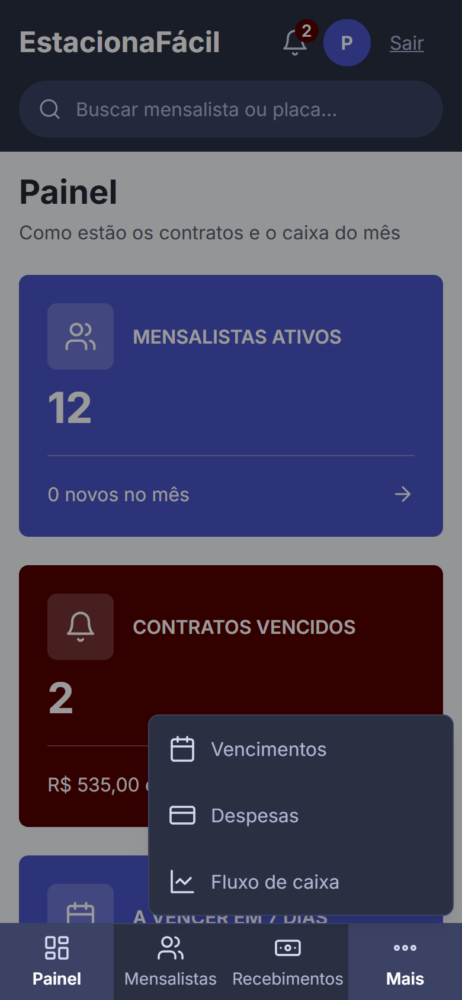

  Aparecem **Vencimentos**, **Despesas** e **Fluxo de caixa**. Toque numa delas para abrir; o menu fecha
  sozinho. (O Auxiliar vê só as abas dele, e todas à mostra, sem o "Mais".)
- **As listas viram cartões.** Em vez de uma tabela larga, cada cliente aparece num cartão, com o **nome em
  cima** (toque nele para abrir os detalhes) e os dados em linhas, com o nome de cada informação ao lado:

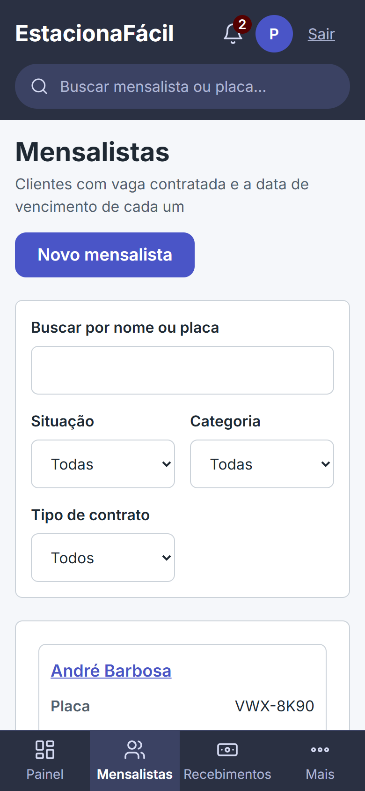

- **Registrar um recebimento** funciona do mesmo jeito que no computador:

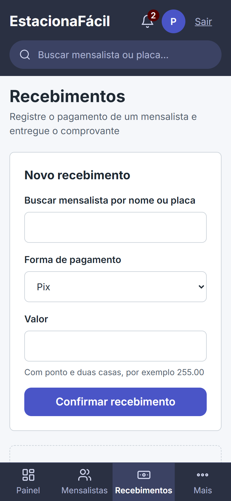

Dicas para o celular:

- Gire o aparelho para o modo **deitado** se quiser ver mais colunas; o sistema se ajusta.
- Para chegar mais rápido, adicione o endereço à **tela inicial** do celular (no menu do navegador, "Adicionar à
  tela inicial").
- Toque **uma vez** nos botões, e espere. Se a internet estiver lenta, o sistema não cobra duas vezes.

## 11. Perguntas e problemas comuns

| Mensagem ou situação | O que significa | O que fazer |
|---|---|---|
| "Usuário ou senha incorretos" | login ou senha errados | confira e tente de novo |
| "Muitas tentativas" | 5 erros em 15 minutos | espere 15 minutos |
| "Sua sessão expirou. Entre de novo." | 12 horas sem uso | entre de novo |
| "Esta placa já tem contrato ativo" | placa repetida | procure o mensalista na lista, ou encerre o contrato antigo |
| "Esta vaga já está ocupada" | vaga de outro cliente | escolha outra vaga ou encerre o outro contrato |
| "Informe o valor com duas casas decimais, como 255.00" | valor com vírgula ou casas demais | digite `255.00` (com ponto) |
| "Contrato não encontrado ou já encerrado" | o contrato foi encerrado | confira nos detalhes do mensalista |
| "Sem conexão com o servidor" | internet caiu | confira a internet e tente de novo; nada foi duplicado |
| A primeira abertura do dia demora alguns segundos | o servidor "acordando" | é normal; espere |
| Valor do Painel não bate com o de Recebimentos | o Painel soma o **mês**, Recebimentos mostra só **hoje** | compare no Fluxo de caixa com as mesmas datas |

### Dicas

- Registre o pagamento **na hora** em que o cliente paga: o vencimento avança sozinho.
- Confira o sininho no começo do dia: ele mostra quantos contratos estão em atraso.
- Os dados pessoais guardados são só **nome, telefone e placa** (não há CPF).
