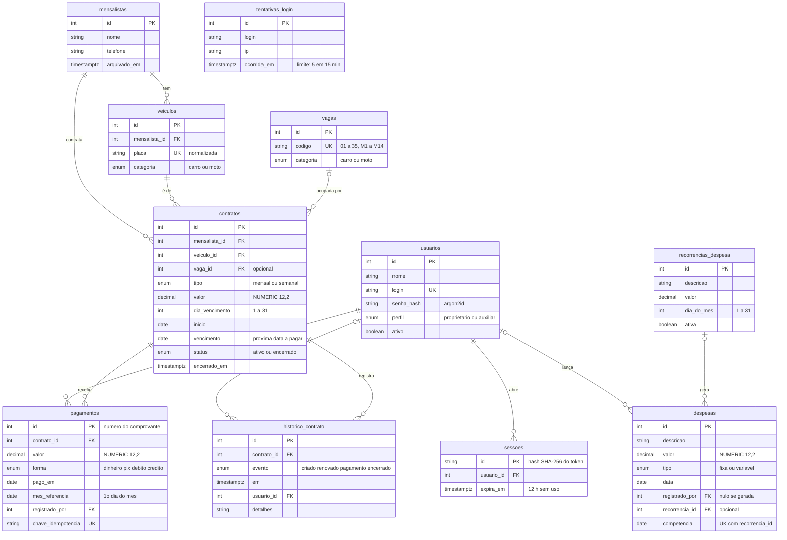

# Modelo de dados

O esquema do banco (PostgreSQL) é definido em [`apps/api/prisma/schema.prisma`](../apps/api/prisma/schema.prisma)
e versionado em migrações SQL (`apps/api/prisma/migrations`). **Ele substitui o DER do MySQL Workbench**
previsto no projeto original (RNF04). Este diagrama é a versão exportada dele.

A fonte editável do diagrama é [`diagramas/modelo-de-dados/modelo_de_dados.mmd`](./diagramas/modelo-de-dados/modelo_de_dados.mmd)
(Mermaid); a imagem pronta é [`modelo_de_dados.svg`](./diagramas/modelo-de-dados/modelo_de_dados.svg).

Versão em texto (o GitHub desenha este bloco)

## Como ler

- `PK` chave primária, `FK` chave estrangeira, `UK` valor único.
- Nos relacionamentos, `||` é "exatamente um", `|o` é "zero ou um" e `o{` é "zero ou muitos". Por exemplo,
  `contratos ||--o{ pagamentos` diz que um contrato recebe zero ou muitos pagamentos, e cada pagamento é de
  exatamente um contrato.
- `tentativas_login` não tem relacionamento de propósito: guarda o login e o IP em texto, inclusive de
  logins que não existem, para o limite de tentativas não revelar quais usuários existem.

## Decisões do modelo

| Decisão | Por quê |
|---|---|
| **A situação do contrato não é uma coluna.** Só existe `vencimento`; "em dia", "a vencer" e "vencido" são calculados pela data | evita uma situação gravada que fica errada na virada do dia |
| **Dinheiro em `NUMERIC(12,2)`** e, na API, texto decimal (`"255.00"`) | nenhum `float` toca em dinheiro; as somas são feitas em centavos inteiros |
| **O contrato guarda o `vencimento` e o `dia_vencimento`** | o dia de pagamento combinado não muda quando o mês é curto (dia 31 cai em 28 ou 29 e volta ao 31 depois) |
| **`mes_referencia` no pagamento** | um pagamento cobre um mês a partir do vencimento atual, não de hoje; o mês fica registrado |
| **`chave_idempotencia` única no pagamento** | clique duplo ou rede lenta não cobram duas vezes |
| **`competencia` na despesa, única com `recorrencia_id`** | a geração mensal da despesa fixa nunca duplica um lançamento |
| **Encerrar um contrato não apaga nada** (`status = encerrado`) | preserva o histórico e libera a vaga e a placa |
| **`historico_contrato`** | linha do tempo de cada contrato: criado, renovado, pago e encerrado, e por quem |

## Regras que o Prisma não mostra

O `schema.prisma` não expressa tudo. Estas regras estão escritas à mão em SQL na migração inicial
(`apps/api/prisma/migrations/20261027120000_base_inicial/migration.sql`):

- **Um contrato ativo por veículo e por vaga**, com dois índices únicos parciais:
  `contratos_um_ativo_por_veiculo` (`WHERE status = 'ativo'`) e `contratos_um_ativo_por_vaga`
  (`WHERE status = 'ativo' AND vaga_id IS NOT NULL`). Encerrar o contrato libera ambos.
- **Seis `CHECK`:** `contratos.valor > 0`, `contratos.dia_vencimento` de 1 a 31, `pagamentos.valor > 0`,
  `despesas.valor > 0`, `recorrencias_despesa.valor > 0` e `recorrencias_despesa.dia_do_mes` de 1 a 31.
- **Row Level Security ligado em todas as tabelas, sem nenhuma política.** Na prática, só a conexão da
  aplicação (dona das tabelas) as acessa; chaves públicas do Supabase não leem nada. A permissão por perfil
  é verificada na API, e o RLS é uma segunda barreira.

Ao criar uma migração nova, **leia o SQL gerado** e habilite o RLS nas tabelas novas: o teste
`apps/api/test/banco.test.ts` falha se alguma ficar sem.

## Dados de partida

As **49 vagas** (35 de carro, códigos `01` a `35`, e 14 de moto, `M1` a `M14`) são criadas por
`npm run semear -w @estacionafacil/api`. O primeiro usuário é criado por
`npm run criar-proprietario -w @estacionafacil/api`; não existe senha padrão.

## Como atualizar o diagrama

1. Mude o `schema.prisma` e a migração, como de costume.
2. Atualize `modelo_de_dados.mmd` e o bloco Mermaid desta página, que precisam ficar iguais.
3. Gere o SVG de novo com qualquer renderizador do Mermaid (por exemplo, o
   [Mermaid Live Editor](https://mermaid.live) ou o `@mermaid-js/mermaid-cli`) e salve em
   `diagramas/modelo-de-dados/modelo_de_dados.svg`.
